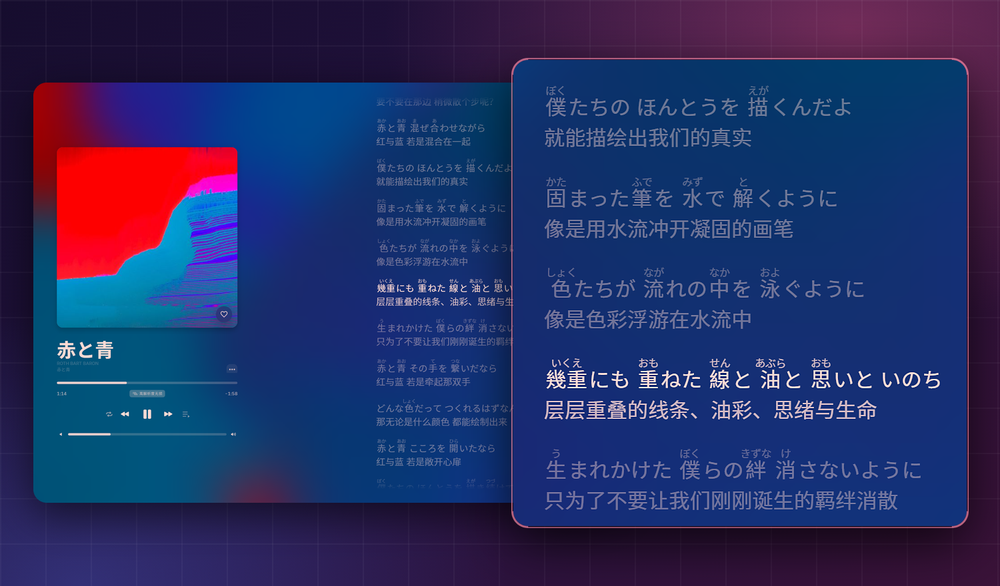

# 日语歌词振假名 · jp-furigana

在网易云音乐的日文歌词的汉字上方标注振假名

## 环境

- 网易云音乐 **2.10.x / 3.x** (在 2.10.13 和 3.1.36 上实测)
- [BetterNCM](https://github.com/std-microblock/BetterNCM) **1.3.4+**

## 安装

从 [Releases](https://github.com/Leleawa/jp-furigana/releases) 下载 `jp-furigana.plugin`, 放进 BetterNCM 的插件目录后重启网易云

## 读音来源

在插件设置的 "读音来源" 里选择:

| 选项 | 说明 |
| --- | --- |
| 优先用网易云音译 (默认) | 换歌时向网易云的歌词接口请求一次官方音译, 对不上的地方用词典补 |
| 只用词典 | 完全离线, 由内置的 kuromoji + IPADIC 词典推读音 |
| 外部网站 | 从 [UtaTen](https://utaten.com/) 获取振假名, 或从 [歌ネット](https://www.uta-net.com/) 获取罗马音再对齐到汉字; 网站没收录或还在加载的行仍用网易云音译 / 词典 |

外部网站默认关闭. 第一次开启时会弹出提示: 歌词和读音的著作权属于权利人及相应网站, 以程序方式获取可能违反网站的使用条款, 请自行判断并仅用于个人学习. 确认后才会联网, 每首歌的歌词和读音缓存在 `<BetterNCM 数据目录>/lyrics/jp-furigana/` 下的一个 JSON 文件里. 想撤回时, 点设置里 "读音来源" 下方的 "撤销外部网站同意", 会切回网易云音译

详细说明见 [外部网站读音来源](docs/external-lyrics.md)

## 人工纠音

注音不对的地方可以手动改:

- **编辑模式**: 在设置里点 "进入编辑模式", 然后在播放页点歌词里的词修改读音. 修改单独保存, 之后重新获取网站数据也会保留
- **本地歌词管理**: 查看、搜索、删除已缓存的歌曲, 或者直接 "播放并编辑"

装了 [RefinedNowPlayingNext](https://github.com/BetterNCM/RefinedNowPlaying) 的话, 播放页的设置菜单里会多一个 "注音" 分页, 常用设置和这两个入口都在里面

## 说明

- 只给含日语原文的歌曲注音, 纯中文、英文歌不处理, 也不会去请求外部网站
- 桌面歌词无效, 那是原生窗口而不是网页

## 致谢

外部网站读音、人工纠音和本地歌词管理由 [@CarrotLouis](https://github.com/CarrotLouis) 贡献 ([#7](https://github.com/Leleawa/jp-furigana/pull/7))

## 许可

插件自身的代码采用 **MIT** 协议, 见 [LICENSE](LICENSE)

打包分发的第三方组件见 [NOTICE.md](NOTICE.md):

| 组件 | 许可 |
| --- | --- |
| `kuromoji.js` | Apache-2.0 ([LICENSE-kuromoji.txt](LICENSE-kuromoji.txt)), 已修改, 文件头带修改说明 |
| `dict/*.dat.gz` | mecab-ipadic-2.7.0-20070801, NAIST + ICOT |
